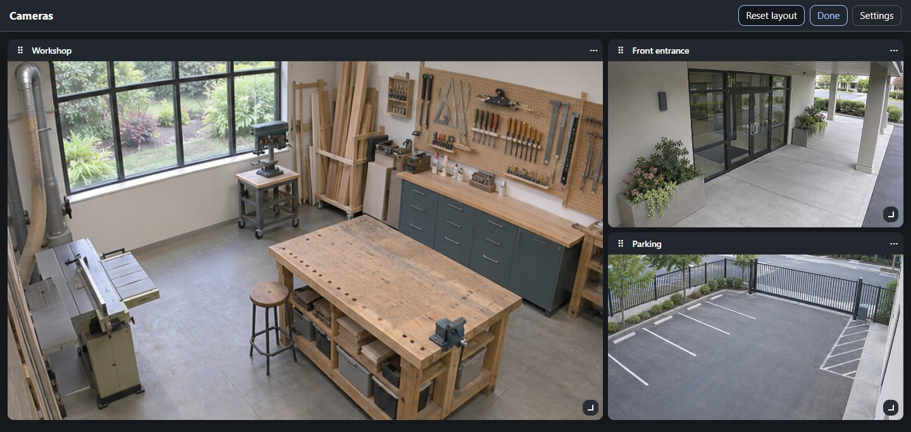
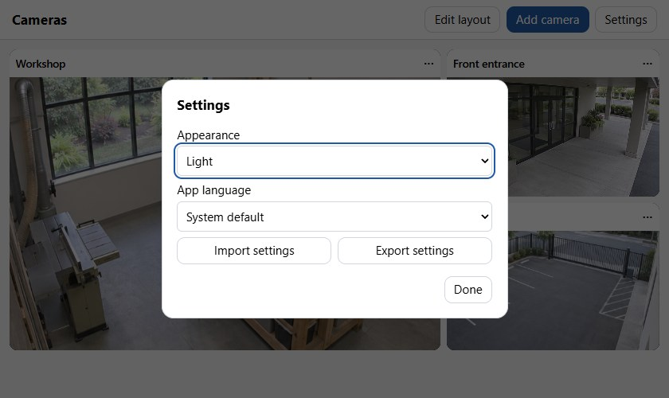

# Local Camera Wall

[](https://github.com/Majkey25/local-camera-wall/actions/workflows/ci.yml)
[](https://github.com/Majkey25/local-camera-wall/releases/latest)
[](#install-on-windows)
[](https://nodejs.org/en/download)

A local Windows dashboard for up to 24 RTSP cameras. Watch live feeds in Chrome or Edge, drag and resize views to arrange the wall, and transfer your setup to another PC in an encrypted file.



*The screenshots show the app with illustrative camera images.*

## Install on Windows

1. Install [Node.js 24 or later for Windows x64](https://nodejs.org/en/download).
2. Download the Windows x64 ZIP and its checksum from the [latest release](https://github.com/Majkey25/local-camera-wall/releases/latest). Compare `Get-FileHash -Algorithm SHA256 .\local-camera-wall-*-windows-x64.zip` with the `.sha256` file.
3. If Windows shows an **Unblock** checkbox in the ZIP's **Properties**, select it after verifying the checksum. Extract the ZIP.
4. Open PowerShell in the extracted folder and run the following commands.

```powershell
npm.cmd ci --ignore-scripts
powershell.exe -NoProfile -ExecutionPolicy RemoteSigned -File .\setup.ps1
.\start.cmd
```

Setup downloads the pinned Windows build of [go2rtc](https://github.com/AlexxIT/go2rtc) and verifies its SHA-256 digest. The launcher builds the interface and opens the dashboard in the browser. Press Ctrl+C in the terminal to stop it. While the app is running, use `%LOCALAPPDATA%\Kamery\open.html` to open another tab.

## Add cameras and arrange the wall

Select **Add camera**. Enter the camera's name, RTSP address, and credentials in their own fields. Substitute the camera's private IPv4 address for `CAMERA_IP`.

| Camera | Example RTSP address |
| --- | --- |
| Imou / Dahua | `rtsp://CAMERA_IP:554/cam/realmonitor?channel=1&subtype=0` |
| Reolink | `rtsp://CAMERA_IP:554/Preview_01_sub` |
| TP-Link Tapo | `rtsp://CAMERA_IP:554/stream1` |

If the browser cannot play the main stream, check the camera settings for an H.264 stream. Some Reolink models require RTSP to be enabled first. Compatible Tapo models use a separate camera account. [Reolink RTSP guide](https://support.reolink.com/articles/900000630706-Introduction-to-RTSP/) · [TP-Link RTSP guide](https://www.tp-link.com/us/support/faq/2680/)

Select **Edit layout** to show the drag and resize handles. Open a camera's **•••** menu to resize or move it with the keyboard, edit its details, or open it full screen. The browser saves the layout automatically. **Reset layout** restores equal sizes and the original order.

## Move your setup to another PC

In **Settings → Export settings**, choose a separate backup password of at least 12 characters. The `.kamery` file encrypts camera addresses, accounts and passwords, layout, theme, and language. Keep its password separate from the file.

On the second PC, open **Settings → Import settings**, choose the file, and enter the backup password. **Replace settings** restores the backup on that PC. The second PC must be able to reach the same camera addresses.



## How it runs locally

The dashboard and go2rtc listen on IPv4 loopback. Both require authentication. Camera streams use your local network and camera passwords are encrypted by Windows DPAPI under the current Windows user. Treat that Windows session and the camera network as trusted. Keep camera ports off the public internet.

The app follows your system's color scheme and browser language by default. In **Settings**, you can set the theme and choose English or Czech.

## Development

Use the Windows setup commands above. Run `npm test` for the test suite and `npm run build` to rebuild the interface. Stop a running dashboard before running `node scripts/smoke.mjs`, which starts the app on its standard local ports with an isolated profile.

To publish a release, update the version in both package files and add a changelog entry. After the main branch checks pass, push a matching annotated version tag in a separate push. Run **Windows CI** manually against that tag if the tag push did not start a workflow.

[Changelog](CHANGELOG.md) · [Security reporting](SECURITY.md) · [Releases](https://github.com/Majkey25/local-camera-wall/releases)
